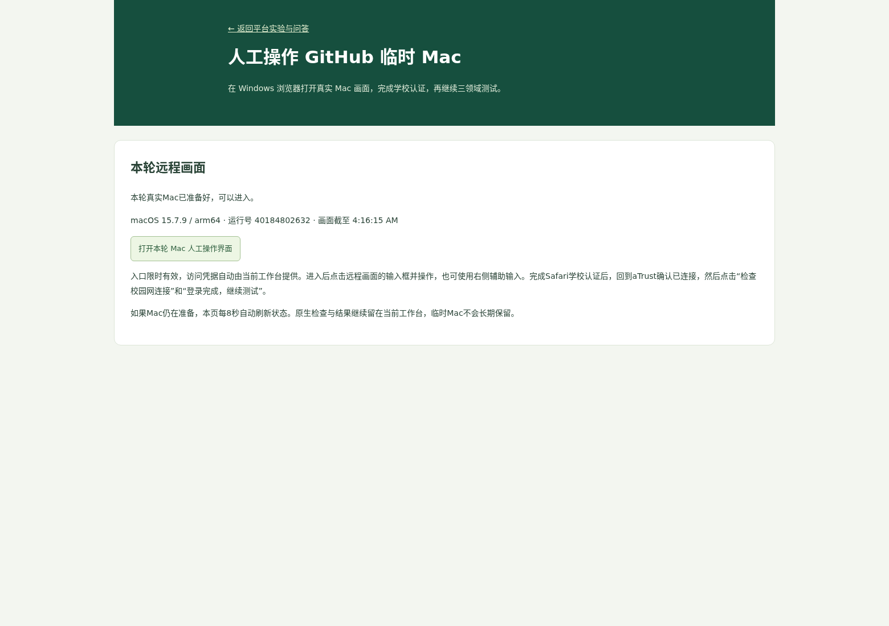
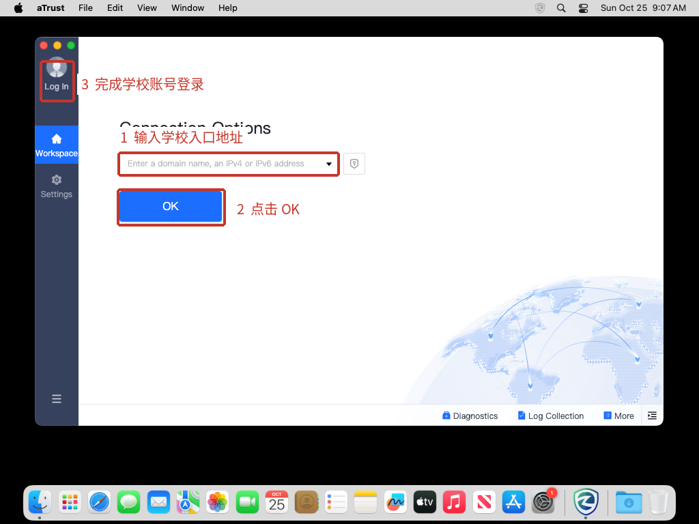

# macOS通过哈工大aTrust直接连接服务器

本方式使用学校提供的aTrust客户端接入校园网，再通过原生SSH访问现有Linux服务器，调用现有模型并回传原生结果。无需经Windows中转，也无需让Mac加入Tailscale。

## 当前实际结果与人工操作

真实运行 **40183181767** 已在macOS15.7.9/ARM64完成客户端安装、进入Safari学校认证页面，并通过正常界面提交过一次本人授权的账号登录。该轮摘要记录 `credentials_used=true`；随后限定时间内仍未连接到校园网SSH入口，`native_completed=false`、`dashboard_imported=false`，没有授予Mac兼容性通过。

下一步需要人工查看学校认证后的提示以及aTrust是否真正显示已连接。现已增加 `atrust-manual` 工作流阶段和现有网站的人工Mac入口。任务结束后该Mac即回收，历史截图不能继续操作；每次人工操作需要进入当前正在运行的临时Mac。

## 在Windows浏览器人工操作GitHub临时Mac

1. 保留当前工作台的SSH端口转发。在Windows打开当前工作台地址，加上 `/macos-manual`。常用地址为 `http://127.0.0.1:28765/macos-manual`。也可从 **平台实验与问答 → 日志与结果导入 → 打开Mac人工操作入口** 进入。
2. 页面自动检查本轮真实Mac是否已准备好。出现 **打开本轮Mac人工操作界面** 按钮后点击；在新标签页操作。访问凭据由工作台自动提供，不需要复制密码或GitHub令牌。
3. 点击远程画面的输入框，再用键盘输入。如果需要从Windows复制粘贴，先点击远程目标输入框，再把内容粘贴到右侧 **辅助输入**，点击 **发送到当前输入框**。发送后辅助输入立即清空。密码框默认隐藏输入，只有本人需要核对时才勾选显示。
4. 若画面仍在aTrust入口，填学校地址并点击OK；主题提示点Later，同意条款，再点Log In。切换到Safari学校认证页完成本人登录、验证码或实际要求的二次认证。可点击程序坞Safari图标，或用右侧 **切换程序 ⌘Tab** 按钮。完成认证后切回aTrust确认实际连接状态。
5. 点击右侧 **检查校园网连接**。它实际探测本轮Mac能否收到校园网SSH入口的服务响应，尚未连通时继续处理学校页面或客户端提示。
6. 显示已连通后，点击 **登录完成，继续测试**。系统再次检查实际SSH，再进行Mac→Linux与Linux→Mac双向验证，随后执行三领域原生项目并把输入输出、检索、原图绑定与日志回传原工作台。
7. 原生阶段开始后，远程输入会锁定。回到原工作台 **平台实验与问答** 查看运行状态、macOS原生案例及日志。

人工登录阶段等待30分钟；远程画面最长45分钟，任务结束或超时会关闭临时HTTPS连接，并清除私有画面缓存。需要提前结束时点击 **结束本轮人工操作**。当前任务已结束时，重新从GitHub Actions选择 `atrust-manual` 启动新一轮。

首次实际人工画面运行号为 **40184802632**；macOS15.7.9/ARM64的受保护画面、真实鼠标点击、键盘按键、校园网检查及原工作台入口已验证。以下为现有网站进入本轮Mac的入口截图，不含校园网账号或远程访问凭据：



远程画面通过Cloudflare临时HTTPS连接传递，每轮需要独立访问凭据；服务只监听Mac本机回环地址。截图、输入文字、账号和访问凭据不放进公开Artifact。公开信息只包含受保护入口的地址、真实系统及到期时间；根访问凭据存储在仓库Secret `KG_MANUAL_ACCESS_TOKEN`，现有服务器以权限600保存对应本地文件，工作台提供本轮授权入口。

## 已确认的官方下载来源

- 哈工大入口：https://ivpn.hit.edu.cn
- 学校入口提供的Mac终端安装包：https://ivpn.hit.edu.cn/resource/client/mac/aTrustInstaller.pkg
- 深信服产品软件目录：https://support.sangfor.com.cn/productSoftware/list?product_id=19&category_id=160

产品软件目录中的“控制台灰度更新ZIP包”“服务端升级bin包”用于管理员升级部署。普通Mac终端应使用学校入口提供的PKG安装包，以匹配学校当前网关。

本次检查到的学校PKG为234726127字节，SHA-256为：

```text
d8f6866aac9407edf348fca1fd890d44fc6c63a1aea4bf92184f1d30a23b719d
```

静态安装包版本为2.5.16.31，主程序及隧道组件为Intel x86_64。Apple Silicon环境须以实际安装和Rosetta运行结果为依据。GitHub工作流会额外使用macOS的pkgutil检查SANGFOR安装签名；安装包内容变化时停止，重新核验后才能更新固定哈希。

## 实际Mac电脑的操作

1. 下载学校PKG，打开安装向导，按提示完成安装。
2. 启动aTrust，服务器地址填入 `https://ivpn.hit.edu.cn`。
3. 本次真实客户端在接入地址确认后显示 **UIA–CAS** 入口。如果弹出主题更新提示，点击 **Later（稍后）**。勾选同意使用条款，点击右侧蓝色 **Log In**，进入学校统一身份认证后登录本人账号。不要将学校CAS账号填入“Local Password Auth”网关本地账号方式。若出现验证码、扫码、二次认证或设备审批，按学校正常流程完成。
4. 在macOS系统设置中完成客户端实际提示的必要授权。不同Mac系统版本、CPU和学校策略可能有不同要求，以现场界面为准。
5. 看到客户端已连接后，在Mac本机终端测试已知SSH入口：

   ```bash
   ssh -o ConnectTimeout=10 -p 60005 dujx@tibaiot.7766.org
   ```

   使用你自己的、已授权的SSH认证方式。校园网账号认证与Linux SSH用户认证是两次独立认证。

6. 在Mac本机终端建立工作台与模型转发：

   ```bash
   ssh -N -T -o ExitOnForwardFailure=yes -o ServerAliveInterval=20 \
     -p 60005 \
     -L 28765:127.0.0.1:18765 \
     -L 28100:127.0.0.1:18100 \
     dujx@tibaiot.7766.org
   ```

7. 保留该终端，浏览器打开 `http://127.0.0.1:28765/#platform-experiments`。可以查看已有Windows结果并实时问答。
8. 在网页的“Windows/macOS测试运行包”下载Mac完整包，解压后在新的Mac本机终端进入解压目录，执行：

   ```bash
   bash ./start-macos-test.command \
     --dashboard-url http://127.0.0.1:28765 \
     --endpoint http://127.0.0.1:28100/v1/chat/completions
   ```

9. 等待三领域检查及实际图文回答完成。启动器保存每轮日志并尝试自动回传；回传成功后，在原网站选择“macOS原生实验”查看题干、原图、回答、检索和日志。

真实运行40180989171确认：点击 **Log In** 后，学校统一身份认证页面在 **Safari浏览器** 打开，aTrust主窗口仍停在UIA–CAS入口。此时应切换到Safari操作，在学校认证页面填写账号；不能仅等待aTrust主窗口出现密码框。完成学校登录后再回到aTrust确认连接状态，并以实际SSH探测确认校园网资源可访问。

本次从官方门户实际观察到的CAS页面来源为 `http://ids-hit-edu-cn-s.vpn.hit.edu.cn:1080`，路径为 `/authserver/login`。它是学校WebVPN给出的认证代理地址，Safari可能省略地址栏中的 `http://`。不要自行把这个1080端口地址改为HTTPS。自动化仅对这个已经核实的固定学校代理识别该显示方式，其他HTTP页面不会套用此规则；完整认证跳转参数、会话Cookie和账号值不写入公开诊断。

### 实际客户端初始界面

以下截图来自真实GitHub macOS15.7.9运行40179212503，截图时未填写账号。红框标出入口地址、OK按钮及登录入口。先在①填入学校地址，再点击②，随后按照学校实际出现的认证页面操作。



## GitHub标准macos-15的验证顺序

工作流增加 `atrust-preflight` 阶段，先在真实Mac检查学校客户端的下载、哈希、签名、安装与启动。该阶段不使用校园网账号，也不授予任何兼容性通过。

运行入口：https://github.com/duhhhh1/kg-macos-test/actions

选择 **macOS native commission tests → Run workflow → atrust-preflight**。首次实际运行号为 **40178251763**。原网站定期同步其真实状态、摘要与日志。

客户端可安装和启动，只是第一步。还必须验证：

1. 学校统一身份认证能在该临时Mac中按正常流程完成。
2. 客户端获得必要的系统权限、后台服务和校园网资源授权。
3. 接入后确实能够连接 `tibaiot.7766.org:60005`，并完成SSH身份验证。
4. Mac→Linux与Linux→Mac反向SSH挑战均通过。
5. 使用同版本交付包运行三领域原生项目，核对实际输入输出并导入原始证据。

真实运行40180516273已经通过入口地址连接，实际出现学校 **UIA–CAS** 入口及主题更新提示；该轮没有进入账号密码表单，没有提交账号。后续工作流已补齐正常的“Later → 同意条款 → Log In”步骤，继续以真实认证页面和校园网SSH结果判断接入情况。

如果实际登录要求验证码、扫码、人工审批或系统界面确认，需要在该步骤完成正常交互。安装成功、网页登录成功、VPN显示在线、SSH连接成功和原生项目测试通过，会分别记录，不能相互替代。

## 仓库中的账号登录与正式测试阶段

仓库新增两个GitHub Actions Repository Secrets：`HIT_VPN_USERNAME` 和 `HIT_VPN_PASSWORD`。登录步骤从Secrets取得值，通过客户端正常的macOS辅助功能界面填写；值不放进源码、命令行参数或公开Artifact，也不传给交付代码及模型进程。

- `atrust-ssh-only`：安装并启动客户端，填写学校入口，尝试一次正常账号登录。校园网SSH可达后，验证Mac→Linux与Linux→Mac双向SSH；不运行项目。
- `atrust-full-tests`：完成同样的接入和双向SSH验证后，执行三领域原生项目，自动回传实际结果与日志。

若界面出现验证码或二次认证，流程停止并记录需要正常交互；账号被拒绝时不重试。没有完成校园网连接时，不进入项目测试。首次账号登录/完整流程尝试的实际运行号会显示在现有网页中。

## 日志与凭据

客户端预检的公开Artifact只保存不含账号的系统、安装与启动结果，以及安装签名和组件信息。校园网密码、会话Cookie、客户端认证缓存不能放进公开Artifact或仓库。

现有网页 **平台实验与问答 → 日志与结果导入 → SSH执行与自动回收** 可查看本仓库实际运行记录。使用“历史Mac执行记录”下拉框选中运行号，再点击“查看所选记录日志”或“下载所选日志包”，可回看之前各轮。原生兼容性仅依据成功导入的实际Mac项目证据更新；跨平台一致性还需与Windows同版本记录逐项对照。
